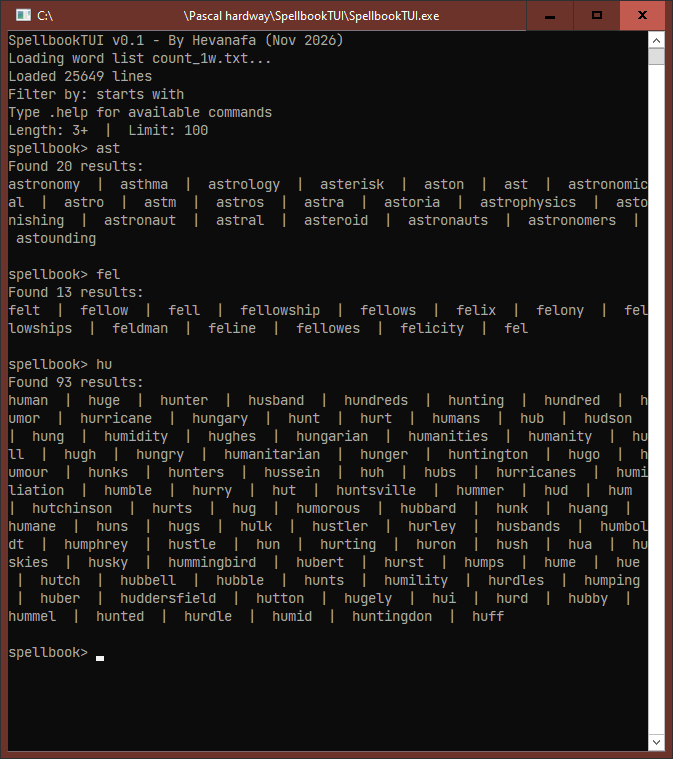

# SpellbookTUI

A word search utility written in Free Pascal



## Getting started

Download the ZIP file from the [Releases](https://github.com/Hevanafa/SpellbookTUI/releases/) page

SpellbookTUI currently requires Peter Norvig's English word frequency list, which can be obtained from here:

[https://www.norvig.com/ngrams/](https://www.norvig.com/ngrams/)

This app uses the `count_1w.txt` file

## Building

SpellbookTUI is a console app that can be built using either Lazarus or the standalone Free Pascal Compiler

### Lazarus IDE

At least Lazarus IDE v4.6 (bundled with FPC 3.2.2) is required to build this app

1. Open `project.lpi` with Lazarus
2. Select the **Release** build mode
3. Press `Shift+F9` or **Run menu > Build**

### Free Pascal Compiler

If you prefer to use the plain Free Pascal Compiler, you can use this command:

```powershell
fpc "-oSpellbookTUI.exe" -O3 .\project.lpr
```
